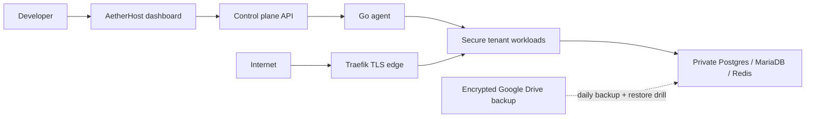

<div align="center">

# ⚡ AetherHost

**Enterprise Multi-Tenant Cloud Platform, AI Software Architect & Container Orchestrator**

*A production-ready Platform-as-a-Service (PaaS) built with NestJS, Next.js 16, Go, and Rust. Features Lovable-style AI application synthesis, live split-view previewing, zero-downtime rolling container deployments, Traefik Let's Encrypt edge routing, and a native Rust systems toolchain.*

[](https://nextjs.org/)
[](https://nestjs.com/)
[](https://go.dev/)
[](https://www.rust-lang.org/)
[](https://traefik.io/)
[](https://www.docker.com/)
[](https://www.postgresql.org/)
[](https://redis.io/)

</div>

---

## 🌟 Executive Overview

**AetherHost** is an end-to-end cloud hosting platform that bridges the gap between infrastructure orchestration (like Render / Railway / Fly.io) and generative software engineering (like Lovable / v0).

Agencies, developers, and enterprises use AetherHost to:
1. **Prompt the AI Architect** to synthesize, commit, push, and deploy fullstack applications in seconds.
2. **Live-Preview Applications In-Dashboard** with responsive desktop, tablet, and mobile viewport controls.
3. **Deploy Container Workloads with Zero Downtime** using HTTP readiness probes and rolling Traefik ingress.
4. **Manage Multi-Tenant Commercial Entitlements** with atomic SQL quota guarantees and automated billing.
5. **Operate High-Performance Rust Infrastructure** including a dedicated developer CLI (`aether-cli`), real-time WebSocket log broker (`aether-logd`), and edge byte-metering proxy (`aether-router`).

---

## 📱 AetherHost Mobile Preview

AetherHost now has a native companion app for operators who need to check a deployment, inspect a failure, update a domain, or start an AI-assisted fix while away from a laptop. It uses the same Clerk account and tenant-scoped API as the web console, so projects and permissions stay in sync.

### Install the current preview

| Device | How to install | What to expect |
|---|---|---|
| **Android** | [Download the signed AetherHost 1.0.0 APK](https://expo.dev/artifacts/eas/rdcVqhytdHMIU6XvV-wzRGkTy1A6ScUs1dDhzIvXsp8.apk) on the device, then open the download and approve the Android install prompt. | A directly installable preview APK. It is not published through Google Play. |
| **iPhone / iPad** | Install [Expo Go](https://expo.dev/go), then open the AetherHost preview when the team provides its Expo link or QR code. | This is a preview inside Expo Go, not a standalone App Store app. |

Android may show an “install unknown apps” confirmation because the APK is downloaded from AetherHost rather than an app store. Only install the release linked above from the official AetherHost site. The preview is deliberately store-free for now; no Play Store or App Store submission is required.

### What the app covers

- See project health, recent deployment events, live logs, and manual redeploy controls.
- Verify custom-domain DNS and HTTPS status without leaving the app.
- View masked environment variables and explicitly reveal a value only when needed.
- Ask the AI operator to diagnose a failed deployment and start a guided follow-up fix.
- Check plan usage, invoices, checkout links, and tenant API keys.
- Opt in to push alerts for deployment starts and failures. Delivery requires the platform notification credentials for the relevant device platform.

### Mobile development and preview builds

The app lives in [`apps/mobile`](apps/mobile). Start it locally after providing the public API URL and Clerk publishable key:

```bash
pnpm install
cp apps/mobile/.env.example apps/mobile/.env
# Set EXPO_PUBLIC_CLERK_PUBLISHABLE_KEY and EXPO_PUBLIC_API_URL in apps/mobile/.env
pnpm --dir apps/mobile start
```

Create a fresh downloadable Android APK with the EAS preview profile:

```bash
pnpm --dir apps/mobile android:apk
```

That command produces a signed APK through Expo Application Services. Update the Android link above after each promoted preview build. iOS previewing currently stays in Expo Go; a standalone iOS installation will require an Apple distribution path such as TestFlight when the product is ready for it.

---

## 🏛️ System Architecture

The current production design, trust boundaries, recovery path, and compatibility rules are documented in [Reliability & Security Architecture](docs/architecture/RELIABILITY_PLATFORM.md).



### Core control-plane map

```
                             Internet Traffic (Wildcard DNS)
                                            │
                             ┌──────────────▼──────────────┐
                             │     Traefik Edge Proxy      │
                             │  - Let's Encrypt Auto TLS   │
                             │  - HTTP (80) -> HTTPS (443) │
                             └──────┬──────────────┬───────┘
                                    │              │
                  ┌─────────────────┴─┐          ┌─┴─────────────────┐
                  │   console.domain  │          │    api.domain     │
                  │ Next.js Dashboard │          │ NestJS API Server │
                  └─────────┬─────────┘          └─────────┬─────────┘
                            │                              │
         ┌──────────────────┼──────────────────────────────┼──────────────────┐
         │                  │                              │                  │
         │           ┌──────▼──────┐                ┌──────▼──────┐           │
         │           │ Clerk Auth  │                │  Groq LLM   │           │
         │           │ Production  │                │ OSS 120B    │           │
         │           └─────────────┘                └─────────────┘           │
         │                                                                    │
         │  Internal Isolated Docker Network (aetherhost-net)                 │
         │  ┌──────────────┐   ┌─────────────┐   ┌─────────────┐              │
         │  │  PostgreSQL  │   │    Redis    │   │ Go Agent    ├───────┐      │
         │  │ (No pub IP)  │   │(Passworded) │   │ Orchestrator│       │      │
         │  └──────────────┘   └─────────────┘   └─────────────┘       │      │
         │                                                             │      │
         │  Rust Infrastructure Subsystem (crates/)                    │      │
         │  ┌──────────────┐   ┌─────────────┐                         │      │
         │  │ aether-logd  │   │aether-router│                         │      │
         │  │(WebSocket WS)│   │(Edge Meter) │                         │      │
         │  └──────────────┘   └─────────────┘                         │      │
         │                                                             │      │
         │  Live Tenant Applications (Auto-provisioned via AI/Git)     │      │
         │  ┌────────────────────────────────────────────────────────┐ │      │
         │  │ my-node-backend.yourdomain.com                         │ │      │
         │  │ python-flask.yourdomain.com            ◄───────────────┘ │      │
         │  │ rust-axum.yourdomain.com                                 │      │
         │  └──────────────────────────────────────────────────────────┘      │
         └────────────────────────────────────────────────────────────────────┘
```

---

## 🚀 Key Production Features

### 1. Lovable / v0 Style Split-View AI Studio
* **In-Dashboard Interactive Live Preview**: Embedded responsive `<iframe>` loading the live container with a simulated browser address bar, refresh controls, and external window launching.
* **Viewport Emulation**: Toggle between **Desktop (100%)**, **Tablet (768px)**, and **Mobile (375px)** device views with smooth CSS transitions.
* **Direct Git Commit & Push**: Prompts sent to the AI Architect synthesize multi-file changes, create conventional Git commits (e.g. `feat: add /api/todos endpoint`), and push directly to GitHub main branch.
* **Source Code Inspector**: Tabbed code explorer showing syntax-highlighted code for all project files with 1-click clipboard copy.
* **Auto-Reload on Deploy**: The preview automatically reloads as soon as container hot-reload and health verification complete.

### 2. Zero-Downtime Blue/Green Deployments
* **HTTP Readiness Probing**: Solves race-condition `502 Bad Gateway` errors. During package installation (`npm install`, `pip install`, `cargo build`), the Go Agent polls container port 3000 until `200 OK` is returned before Traefik exposes the route.
* **Automatic Rollback**: If a build fails or times out (60s), the failed container is automatically torn down and the failure reason is recorded.

### 3. Universal Real-Time Terminal Log Streaming & AI Debugger
* **Accessible Across All States**: Open logs at any time for `pending`, `running`, or `failed` applications.
* **Obsidian Terminal Interface**: Formatted dark-mode terminal with auto-scrolling, live polling, and full lifecycle timestamps.
* **1-Click AI Root-Cause Debugger**: If an application crashes or fails health checks, click "Analyze Failure with AI" to receive an immediate plain-English explanation and fix from Groq.

### 4. Native Rust Infrastructure Toolchain (`crates/`)
Built with modern, memory-safe Rust:
* **`aether-cli`**: The official developer CLI. Installable binary with zero runtime dependencies. Features colored tables, interactive spinners, instant `aether status`, `aether list`, `aether logs`, and terminal-based AI generation (`aether ai <id> "<prompt>"`).
* **`aether-logd`**: Sub-millisecond log ingestion daemon with Tokio broadcast channels and WebSocket multiplexing (`/ws/:app_id`) for zero-GC real-time log distribution.
* **`aether-router`**: High-performance reverse proxy with per-tenant byte metering and a Prometheus `/metrics` endpoint for accurate bandwidth billing.

### 5. Multi-Tenant Entitlements & Atomic SQL Quota Guard
* **Atomic Concurrency Protection**: Quota allocation uses atomic SQL conditions (`UPDATE ... WHERE usage < limit`), preventing race conditions and overselling even under heavy parallel load.
* **3-Tier Subscription Plans**: Starter, Pro, and Enterprise tiers with live upgrade modals, invoice tracking, and customer portal.
* **Admin Governance Suite**: Superadmin console with global revenue and tenant charts, tenant search, one-click plan adjustments, account suspensions, and refund processing.

### 6. Contabo VPS Production Package
* **Traefik Automated Let's Encrypt**: Ports 80 & 443 with automatic HTTP &rarr; HTTPS redirection and ACME TLS certificate management.
* **Database & Port Isolation**: PostgreSQL 5432 and Redis 6379 are bound strictly to `127.0.0.1` and internal network `aetherhost-net`.
* **Turnkey Ubuntu Bootstrap**: [deploy/setup-contabo.sh](deploy/setup-contabo.sh) configures 4GB NVMe swap space, Docker CE, UFW firewall rules (ports 22, 80, 443 only), and Fail2Ban in one command.
* **Production Manual**: Complete step-by-step runbook in [docs/CONTABO_DEPLOYMENT.md](docs/CONTABO_DEPLOYMENT.md).

### 7. Mobile Operations Companion
* **Same tenant boundary everywhere**: Mobile authentication is handled by Clerk and every project, domain, log, environment, billing, and API-key request remains tenant-scoped by the control-plane API.
* **Away-from-desk diagnostics**: Deployment timelines, live logs, domain DNS/HTTPS checks, and AI deployment insights put the most useful operator signals on a small screen.
* **Store-free preview delivery**: A signed Android APK is available directly from the marketing site while iPhone testing remains in Expo Go.
* **Operational Recovery**: Encrypted off-host backup scripts, a non-destructive weekly restore drill, and bounded Docker cache maintenance. See [docs/OPERATIONS.md](docs/OPERATIONS.md).

---

## 🛠️ Technology Stack

| Layer | Technologies |
|---|---|
| **Frontend Console** | Next.js 16 (App Router), React 19, Tailwind CSS, Framer Motion, Lucide Icons |
| **Control Plane API** | NestJS, Prisma ORM, Clerk Express SDK, Groq SDK, BullMQ |
| **Orchestration Agent** | Go 1.22, Docker Engine API, Traefik dynamic provider |
| **Systems & CLI (Rust)** | Rust 1.80+, Tokio, Axum, Clap, Reqwest, Comfy-Table, Indicatif |
| **Data & Cache** | PostgreSQL 16 (Alpine), Redis 7 (Alpine) |
| **Edge & Ingress** | Traefik v3, Let's Encrypt ACME |
| **AI Inference** | Groq (`openai/gpt-oss-120b`) |

---

## 💻 Local Quickstart

### Prerequisites
* [Node.js 18+](https://nodejs.org/) & [pnpm 9+](https://pnpm.io/)
* [Docker Desktop](https://www.docker.com/)
* [Go 1.22+](https://go.dev/) (optional, for local agent compilation)
* [Rust 1.80+](https://rustup.rs/) (optional, for CLI & Rust daemons)

### 1. Clone & Install Dependencies
```bash
git clone https://github.com/Emjaay20/AetherHost.git
cd AetherHost
pnpm install
```

### 2. Start Core Infrastructure
```bash
docker compose up -d postgres redis traefik agent
```

### 3. Initialize Database Schema
```bash
pnpm -F @aetherhost/api prisma db push
```

### 4. Launch Services
```bash
# Terminal 1: Start API Control Plane
pnpm -F @aetherhost/api start:dev

# Terminal 2: Start Dashboard Console
pnpm -F dashboard dev
```

Visit the dashboard at [http://localhost:3002](http://localhost:3002) and explore the console!

---

## 🦀 Rust Developer CLI & Systems Toolchain

### 1-Line CLI Quick Install
Install the official `aether` binary directly to your terminal:
```bash
curl -fsSL https://console.aetherhost.com.ng/install.sh | bash
```
*(Or install via Cargo from source: `cargo install --git https://github.com/Emjaay20/AetherHost.git aether-cli`)*

### CLI Usage
```bash
# 1. Log in with your Personal API Key (generated in Settings > API Keys)
aether login --token aeth_...

# 2. Verify connection to the production cloud
aether status

# 3. List your active applications
aether list

# 4. Provision a new application
aether create my-app --runtime nodejs

# 5. Stream container build & runtime logs
aether logs <app-id>

# 6. Prompt the AI Architect to synthesize code and push to Git
aether ai <app-id> "Add a REST endpoint /api/health that returns uptime"
```

AetherHost also includes two backend Rust system daemons:
```bash
# Run the WebSocket Log Ingestion Daemon (zero-GC real-time logs)
PORT=4001 cargo run --release -p aether-logd

# Run the Edge Reverse Proxy & Bandwidth Meter
ROUTER_PORT=8080 DEFAULT_BACKEND=http://127.0.0.1:3000 cargo run --release -p aether-router
```

---

## 🌐 Contabo VPS Deployment (Turnkey)

Deploying AetherHost to a production Ubuntu VPS on Contabo takes 4 steps:

### 1. SSH into your VPS
```bash
ssh root@<YOUR_CONTABO_IP>
```

### 2. Clone & Run the Bootstrap Script
```bash
mkdir -p /opt/aetherhost
git clone https://github.com/Emjaay20/AetherHost.git /opt/aetherhost
cd /opt/aetherhost
bash deploy/setup-contabo.sh
```

### 3. Configure Production Environment
```bash
cp .env.production.example .env
nano .env   # Set BASE_DOMAIN, CLERK keys, and GROQ_API_KEY
```

### 4. Launch with Docker Compose
```bash
docker compose -f docker-compose.prod.yml up -d postgres redis
docker compose -f docker-compose.prod.yml run --rm api pnpm prisma db push
docker compose -f docker-compose.prod.yml up -d --build
```

📖 *Read the complete production manual in [docs/CONTABO_DEPLOYMENT.md](docs/CONTABO_DEPLOYMENT.md).*

---

## 🔒 Security Hardening

* **Database Non-Exposure:** PostgreSQL (5432) and Redis (6379) are bound strictly to `127.0.0.1` and internal networks. No public internet access.
* **UFW Firewall:** Server firewall allows only SSH (22), HTTP (80), and HTTPS (443).
* **Brute-Force Protection:** Fail2Ban monitors and bans repetitive SSH authentication attacks.
* **Internal Agent Authentication:** Internal API communication requires cryptographically validated `x-agent-key` headers.
* **Memory Safety:** Rust components eliminate memory corruption, buffer overflows, and data races at the proxy and log layers.

---

## 📄 License

Distributed under the MIT License. See `LICENSE` for more information.
