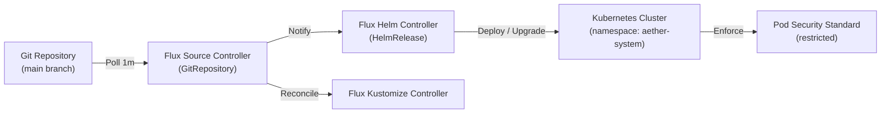

# AetherHost Kubernetes & GitOps Architecture

This document formalizes the deployment architecture, scaling strategy, and GitOps lifecycle for AetherHost across single-node edge instances and distributed Kubernetes clusters.

---

## 1. Architectural Decision Record (ADR 004): Single-Node Compose vs. Multi-Node Kubernetes

### Context
AetherHost serves two primary execution models:
1. **Tier-1 Edge / Control Plane (Current Production - `194.163.172.101`)**: Single-tenant or compact multi-tenant orchestrator running on hardened bare-metal / VPS compute.
2. **Tier-2 Distributed Engine (`deploy/helm`, `deploy/gitops`), design only and not deployed**: a multi-node workload executor intended for managed Kubernetes (EKS, GKE) or k3s. The chart is validated in CI on a throwaway KinD cluster; no long-running cluster runs it.

### Decision
- **Production Edge Nodes**: Run hardened **Docker Compose** (`docker-compose.prod.yml`). This eliminates Kubernetes control plane memory overhead (~1.5GB to 2GB RAM), avoids etcd quorum latency across single nodes, and keeps the blast radius minimal using Linux namespaces, `read_only: true`, `cap_drop: [ALL]`, and the read-only Docker socket proxy.
- **Enterprise / Scaled Workloads**: Deploy via **Flux v2 GitOps** and the **Helm Chart** (`deploy/helm/aether-platform`). All cluster manifests are strictly version-controlled, declarative, and enforced with Kubernetes Pod Security Standards (`restricted`).

### Rationale & Trade-offs
| Dimension | Docker Compose (Current Production) | Kubernetes + Flux v2 (Enterprise Roadmap) |
| :--- | :--- | :--- |
| **Compute Overhead** | Minimal (< 100MB daemon footprint) | Moderate (etcd, kubelet, coredns, CNI ~ 1.5GB) |
| **Recovery Time (MTTR)** | Rapid local daemon restart; 5m restore check | Node failover in 30-60s via scheduler |
| **Scaling Horizon** | Vertical (up to 64 cores / 256GB RAM) | Horizontal (HPA 3 to 15+ replicas across nodes) |
| **Security Envelope** | Linux capabilities, cgroups v2, socket proxy | PSS `restricted`, NetworkPolicies, PodDisruptionBudgets |
| **Deployment Model** | Pushed via SSH least-privilege script from CI | Pulled via GitOps reconciliation loops (Flux) |

---

## 2. Helm Chart Architecture (`deploy/helm/aether-platform`)

The production chart packages the core edge platform components (`aether-router` and `aether-logd`):

```
deploy/helm/aether-platform/
├── Chart.yaml                  # Chart metadata (v0.1.0)
├── values.yaml                 # Defaults, resource limits, security context
└── templates/
    ├── deployment.yaml         # Non-root pod spec with hardened securityContext
    ├── service.yaml            # ClusterIP service definitions
    ├── ingress.yaml            # Traefik IngressRoute with TLS termination
    ├── hpa.yaml                # Horizontal Pod Autoscaler (75% CPU / 80% RAM)
    ├── pdb.yaml                # PodDisruptionBudget (minAvailable: 2)
    └── servicemonitor.yaml     # Prometheus Operator telemetry endpoint
```

### Pod Security Standard (`restricted`)
All pods deployed by this chart adhere strictly to Kubernetes `restricted` security profiles:
- `readOnlyRootFilesystem: true`
- `runAsNonRoot: true`
- `runAsUser: 10001`
- `allowPrivilegeEscalation: false`
- `capabilities.drop: ["ALL"]`
- `seccompProfile.type: RuntimeDefault`

---

## 3. GitOps Continuous Delivery (`deploy/gitops`)

AetherHost adopts the GitOps methodology using **Flux v2** for declarative cluster reconciliation:



### GitOps Manifests
- **[namespace.yaml](../deploy/gitops/namespace.yaml)**: Enforces namespace-level restricted PSS and audit logging.
- **[gitrepository.yaml](../deploy/gitops/gitrepository.yaml)**: Configures Git sync targeting `deploy/helm/aether-platform` and `deploy/gitops`.
- **[helmrelease.yaml](../deploy/gitops/helmrelease.yaml)**: Automates canary rollouts, auto-rollback on failure (`remediation.retries: 3`), and sets replica limits.
- **[kustomization.yaml](../deploy/gitops/kustomization.yaml)**: Reconciles all Kubernetes resources every 10 minutes with state pruning.

---

## 4. Operational Runbook

### Validating Helm Chart Locally
```bash
# Lint the chart against Kubernetes best practices
helm lint deploy/helm/aether-platform

# Render templates with default values
helm template aether-platform deploy/helm/aether-platform --namespace aether-system
```

### Bootstrapping Flux v2 onto a Cluster
```bash
# 1. Install Flux CLI
curl -s https://fluxcd.io/install.sh | sudo bash

# 2. Check cluster prerequisites
flux check --pre

# 3. Bootstrap repository
flux bootstrap github \
  --owner=Emjaay20 \
  --repository=AetherHost \
  --branch=main \
  --path=deploy/gitops \
  --personal
```
# Kyverno admission test (isolated KinD)

`policies/kyverno/security.yaml` contains draft enforcement policies for the
platform signing identity and restricted workload Pods. The signer expression
is checked against `verify-image.sh`; system namespaces are excluded. Kyverno
3.9.2 / CLI 1.19.2 are pinned in CI. ClusterPolicy is deprecated by Kyverno and
must be migrated before a future incompatible Kyverno upgrade.

The CI smoke test installs the chart with its locally built `:latest` image
**before** Kyverno is installed. It then checks a digest-pinned synthetic chart
using server-side dry run, and checks that a non-verifiable platform digest and
insecure Pod fixtures are rejected. The synthetic image does not match the
platform signature policy. A separate post-publication job now tests the exact
published signed digest and denies the same release by tag, using read-only GHCR
access; production deployment waits on it. The [main-branch CI test](https://github.com/Emjaay20/AetherHost/actions/runs/46122103762)
accepted a freshly signed platform digest and rejected its tag-only reference.
Do not describe this as live
production admission enforcement. Review namespace exclusions, registry and
transparency-log availability, failure behavior and Kubernetes upgrades before
installing on a real cluster.

```sh
kyverno test deploy/policies/kyverno/tests
python3 scripts/security/check-image-policy-identity.py
# In an isolated cluster with Kyverno installed and policies applied:
bash scripts/security/test-kyverno-admission.sh
```
