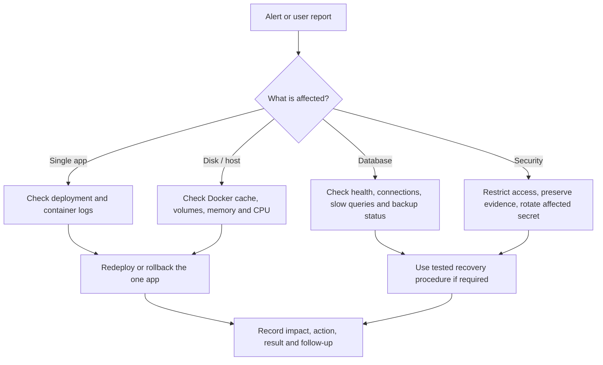

# AetherHost Operations Runbook

This runbook makes day-two operations explicit: observe, contain, recover, and record the outcome. It complements the Contabo deployment guide; it does not replace normal change review or provider snapshots.

## Operating controls

| Control | Schedule | Safe behavior |
| --- | --- | --- |
| Docker cache maintenance | daily at 03:30 | caps BuildKit at 10GB and removes unused images older than seven days; never removes volumes |
| Encrypted backup | daily at 02:30 | backs up platform configuration, data volumes, and control-plane dump; excludes rebuildable images/cache |
| Restore drill | Daily at 04:15 | validates and restores into a temporary directory only; it never overwrites production data |
| Application health | every deploy | failed readiness probe tears down only the newly-created workload |

Install the timers after deployment:

```bash
sudo /srv/aetherhost/control/deploy/install-operations-timers.sh
systemctl list-timers --all 'aetherhost-*'
```

Configure Google Drive before enabling a real backup run: see [Google Drive setup](../deploy/backup/GOOGLE_DRIVE_SETUP.md).

Backups stage data only in `/var/lib/aetherhost/backup-staging`, a fixed
root-owned path. This is intentional: Restic can then identify the preceding
snapshot and perform incremental work. The service has a four-hour maximum
runtime; a timeout is a failed backup that requires investigation, never a
successful recovery point.

## Failure alerts

Backup, restore-drill, and Docker-maintenance failures can notify an
operations-only Slack channel. The webhook is deliberately kept in a root-owned
file outside the repository:

```bash
sudo install -d -m 0700 /etc/aetherhost
sudo install -m 0600 /srv/aetherhost/control/deploy/operations.env.example /etc/aetherhost/operations.env
sudoedit /etc/aetherhost/operations.env
sudo /srv/aetherhost/control/deploy/install-operations-timers.sh
```

Without a webhook, the failed operation remains visible in `systemctl` and the
journal; it is never reported as a successful notification. Test after adding
the webhook by running a controlled failing unit, then confirm both delivery
and the journal record without copying any secrets into a ticket.

## Protected filesystem layout

AetherHost's platform source and tenant workspaces must be separate. This
keeps an application deployment such as FlowMeet inside AetherHost while
preventing it from replacing the API, dashboard, agent, or operational scripts.

```text
/srv/aetherhost/control       platform checkout and compose configuration
/srv/aetherhost/projects      one writable directory per hosted application
/etc/aetherhost               root-owned secrets and backup configuration
```

For a legacy installation that used `/opt/aetherhost` for both roles, run the
additive migration. It copies files and leaves the original directory intact:

```bash
sudo /opt/aetherhost-release-2ec3d0f/deploy/migrate-control-plane-layout.sh
```

Google Drive remains the supported off-host backup destination. The backup
script deliberately limits Restic/rclone concurrency and retries transient
Drive quota errors instead of treating Drive capacity as the problem.

## First-response guide



## Backup recovery guardrails

- Never test a restore by overwriting the live PostgreSQL or a live volume.
- Keep the restic repository passphrase in a password manager separate from Google Drive credentials.
- Rotate any secret that was accidentally exposed; Git ignore rules prevent local environment files from being committed, but ignore rules cannot remove a secret that has already been shared elsewhere.
- Keep Contabo snapshots as a complementary provider-level recovery option; they are not a substitute for application-consistent, off-host backups.

## Portfolio evidence

Keep these sanitized artifacts in the repository or application docs:

1. Current architecture diagram and trust-boundary explanation.
2. A passing backup and restore-drill record (with secrets and user data removed).
3. A Docker cache incident/capacity report showing the 10GB bound.
4. A load-test report for an Nginx/PHP or image workload.
5. An incident note showing detection, containment, recovery, and prevention.

## WordPress workload drill

Run this only against a locally provisioned test application. It deliberately
does not target the deployed VPS.

1. Confirm `aetherhost_wordpress_ready` is `1` and Grafana shows PHP-FPM,
   MariaDB, and Redis metrics for the test application.
2. Start the reproducible load test with `WORDPRESS_URL=http://<test-host> k6
   run scripts/wordpress-load-test.js`.
3. During the ramp, stop only the test workload's MariaDB container. Record the
   user-visible error, readiness state, alert timestamp, and recovery time
   after restarting it.
4. Run the WordPress backup and restore procedure into a fresh test workload.
   Verify a known post and uploaded file by checksum and browser request.
5. Record measured values in `docs/CASE_STUDY.md`; do not copy customer data,
   passwords, or bearer credentials into the report.

The agent's `/metrics` endpoint is reachable only from Docker networks and is
scraped as `agent:9108` by Prometheus. PHP-FPM status stays loopback-only inside
nginx; MariaDB and Redis are queried through the agent's existing Docker
authority and have no public metrics endpoint.

---

## CI Pipeline Performance & Measured Job Durations

To track CI execution times across our polyglot repository (Rust, TypeScript, Go, Terraform, Kubernetes), per-job median durations for `.github/workflows/ci.yml` were computed directly from GitHub Actions run telemetry (`gh run list` and `gh run view <id> --json jobs`).

### Measured Per-Job Median Durations

Durations below are measured medians across three distinct cohorts:
1. **Pre-`4e7a61b` Baseline (`2026-11-15T12:57:40Z` – `2026-11-15T13:22:36Z`, plus `main` runs through `2026-11-16T08:30:43Z`)**:
   - The 4 historical baseline runs prior to commit `4e7a61b` (`2026-11-16T08:49:01Z`): `#43716481729`, `#43716554681`, `#43718567328`, `#43718680336` (and the 6 pre-`4e7a61b` `main` push runs on 15–16 Nov: `#43677164777`, `#43699292346`, `#43699543713`, `#43716554681`, `#43718680336`, `#43831806981`). Prior to `4e7a61b`, path filtering, Checkov, KinD validation, `aether-authz`, `aether-telemetry`, `cargo-nextest`, and `cargo-deny` were not yet in the workflow.
2. **Full Runs on `main` (`gh run list --branch main --workflow ci.yml --limit 15`, `2026-11-16T10:05:02Z` – `2026-11-19T19:06:54Z`)**:
   - 15 runs: `#44594918177`, `#44589860918`, `#44518138456`, `#44516244813`, `#44399936658`, `#44394253338`, `#44224694009`, `#44222231679`, `#43856640904`, `#43855449758`, `#43854420281`, `#43849514837`, `#43848291509`, `#43847043368`, `#43845593490`.
3. **Pull Request Runs with Path-Filter Skipping (`gh run list --event pull_request --workflow ci.yml --limit 15`, `2026-11-19T11:50:52Z` – `2026-11-20T03:43:23Z`)**:
   - 15 runs: `#44669630947`, `#44669564173`, `#44594673971`, `#44593309032`, `#44590495378`, `#44590491186`, `#44590482218`, `#44590481827`, `#44590455673`, `#44589610058`, `#44518463092`, `#44518458856`, `#44518459017`, `#44518450630`, `#44518447501`.

| Workflow Job | Pre-`4e7a61b` Baseline Median | Full Runs on `main` Median (n=15) | PR Runs Median (Path-Skipped vs. Executed) | Measured Scope & Execution Notes |
| :--- | :--- | :--- | :--- | :--- |
| **Change Detection & Path Filter** | *No baseline (added in `4e7a61b`)* | **5.0s** (range 4s–11s) | **5.0s** (always runs; range 4s–10s, n=15) | `dorny/paths-filter` checkout and diff evaluation |
| **API, Shared Libs & Dashboard** (TypeScript) | **42.0s** (4 cited runs; **42.0s** across 6 `main` runs) | **43.0s** (range 34s–50s) | **4.0s** when path-skipped (range 2s–4s, n=5)<br>**51.5s** when executed (n=10 all; **54.0s** across 8 passing) | `pnpm` cache, Prisma client generation, API unit/e2e tests, Dashboard typecheck & tests |
| **Go Runtime Agent** (Go) | **14.0s** (4 cited runs; **14.0s** across 6 `main` runs) | **16.0s** (range 9s–29s) | **4.0s** when path-skipped (range 2s–7s, n=15) | `go vet` and unit tests with Go module cache |
| **Rust Crates** (`aether-core`, `aether-cli`, `aether-logd`, `aether-router`, `aether-authz`, `aether-telemetry`) | **22.0s** (4 cited runs; **24.0s** across 6 `main` runs, 4 crates before `4e7a61b`) | **107.0s / 1m 47s** (n=15 all; **107.5s** across 14 passing, range 95s–119s; 107s on `#44594918177`) | **16.0s** when path-skipped (range 13s–25s, n=14; action setup runs before step skip) | Toolchain setup, `Swatinem/rust-cache`, `cargo-nextest` install & run, `cargo-deny`, `clippy -D warnings`, doc tests |
| **Security and Dependency Checks** | **12.0s** (4 cited runs; **16.0s** across 6 `main` runs) | **23.0s** (range 17s–38s) | **21.0s** (always runs; range 17s–31s, n=15) | Security policy unit tests, Gitleaks secret scan, Trivy filesystem scan |
| **Terraform Security Analysis (Checkov)** | *No baseline (added in `4e7a61b`)* | **18.0s** (range 15s–226s) | **10.0s** when path-skipped (range 9s–14s, n=15; Checkov action prep runs before step skip) | Terraform `init -backend=false`, `validate`, and Checkov static analysis |
| **Kubernetes KinD & Helm Deployment Validation** | *No baseline (added in `4e7a61b`)* | **164.0s / 2m 44s** (range 140s–174s; 155s / 2m 35s on `#44594918177`) | **4.0s** when path-skipped (range 2s–7s, n=14) | Helm lint, `kubeconform`, KinD cluster boot, Docker image build & load, admission negative test, endpoint smoke tests |

### Pipeline Engineering Details
1. **Concurrency Group Cancellation**: Redundant superseded runs on pull requests are automatically cancelled (`concurrency: group: ${{ github.workflow }}-${{ github.ref }}, cancel-in-progress: ${{ github.ref != 'refs/heads/main' && github.ref != 'refs/heads/master' }}`), preventing runner queue starvation during rapid iterations (for example, PR run `#44669564173` was cancelled in favor of `#44669630947`).
2. **Reliable Merge Gating with Path Filtering**: Unchanged language checks on pull requests execute a fast pass-through step (`Skip check when unchanged`) rather than omitting the job, ensuring required GitHub branch protection checks always report a status. Jobs that reference composite/container actions (`rust-crates`, `terraform-checkov`) still incur GitHub Actions runner action-preparation time (median **16.0s** and **10.0s** respectively) even when all build steps are skipped.
3. **Supply Chain Security Gate**: Integrated `cargo-deny` in CI verifying license compliance, banning untrusted dependencies, and checking RUSTSEC vulnerability advisories.

