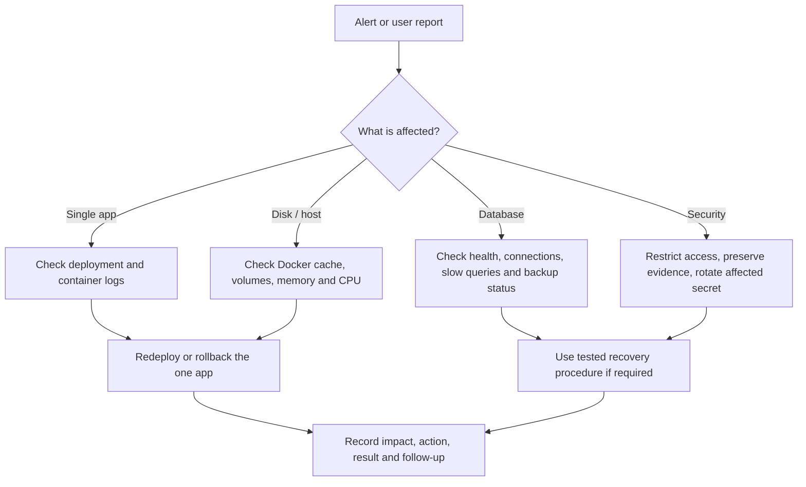

# AetherHost Operations Runbook

This runbook makes day-two operations explicit: observe, contain, recover, and record the outcome. It complements the Contabo deployment guide; it does not replace normal change review or provider snapshots.

## Operating controls

| Control | Schedule | Safe behavior |
| --- | --- | --- |
| Docker cache maintenance | daily at 03:30 | caps BuildKit at 10GB and removes unused images older than seven days; never removes volumes |
| Encrypted backup | daily at 02:30 | backs up platform configuration, data volumes, and control-plane dump; excludes rebuildable images/cache |
| Restore drill | Sunday at 04:15 | validates and restores into a temporary directory only; it never overwrites production data |
| Application health | every deploy | failed readiness probe tears down only the newly-created workload |

Install the timers after deployment:

```bash
sudo /opt/aetherhost/deploy/install-operations-timers.sh
systemctl list-timers --all 'aetherhost-*'
```

Configure Google Drive before enabling a real backup run: see [Google Drive setup](../deploy/backup/GOOGLE_DRIVE_SETUP.md).

## First-response guide



## Backup recovery guardrails

- Never test a restore by overwriting the live PostgreSQL or a live volume.
- Keep the restic repository passphrase in a password manager separate from Google Drive credentials.
- Rotate any secret that was accidentally exposed; Git ignore rules prevent local environment files from being committed, but ignore rules cannot remove a secret that has already been shared elsewhere.
- Keep Contabo snapshots as a complementary provider-level recovery option; they are not a substitute for application-consistent, off-host backups.

## Portfolio evidence

Keep these sanitized artifacts in the repository or application docs:

1. Current architecture diagram and trust-boundary explanation.
2. A passing backup and restore-drill record (with secrets and user data removed).
3. A Docker cache incident/capacity report showing the 10GB bound.
4. A load-test report for an Nginx/PHP or image workload.
5. An incident note showing detection, containment, recovery, and prevention.
