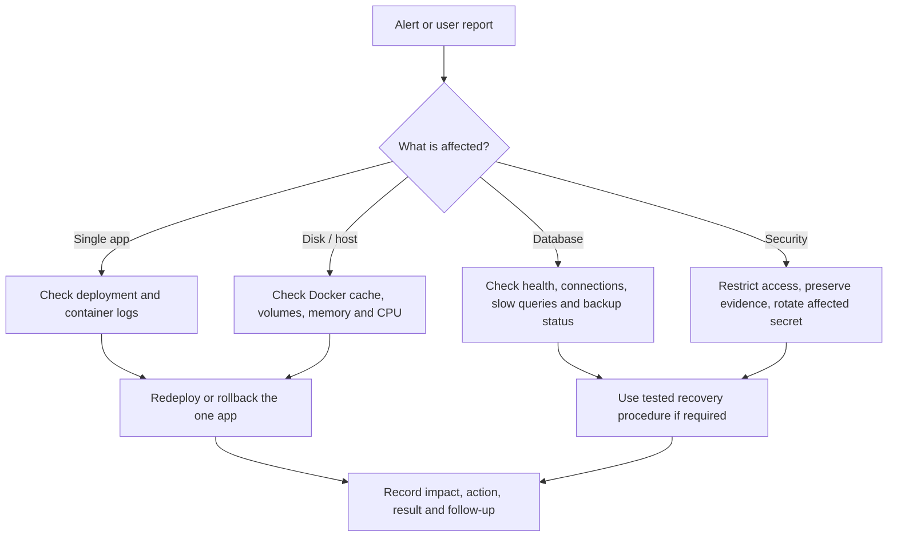

# AetherHost Operations Runbook

This runbook makes day-two operations explicit: observe, contain, recover, and record the outcome. It complements the Contabo deployment guide; it does not replace normal change review or provider snapshots.

## Operating controls

| Control | Schedule | Safe behavior |
| --- | --- | --- |
| Docker cache maintenance | daily at 03:30 | caps BuildKit at 10GB and removes unused images older than seven days; never removes volumes |
| Encrypted backup | daily at 02:30 | backs up platform configuration, data volumes, and control-plane dump; excludes rebuildable images/cache |
| Restore drill | Sunday at 04:15 | validates and restores into a temporary directory only; it never overwrites production data |
| Application health | every deploy | failed readiness probe tears down only the newly-created workload |

Install the timers after deployment:

```bash
sudo /srv/aetherhost/control/deploy/install-operations-timers.sh
systemctl list-timers --all 'aetherhost-*'
```

Configure Google Drive before enabling a real backup run: see [Google Drive setup](../deploy/backup/GOOGLE_DRIVE_SETUP.md).

## Protected filesystem layout

AetherHost's platform source and tenant workspaces must be separate. This
keeps an application deployment such as FlowMeet inside AetherHost while
preventing it from replacing the API, dashboard, agent, or operational scripts.

```text
/srv/aetherhost/control       platform checkout and compose configuration
/srv/aetherhost/projects      one writable directory per hosted application
/etc/aetherhost               root-owned secrets and backup configuration
```

For a legacy installation that used `/opt/aetherhost` for both roles, run the
additive migration. It copies files and leaves the original directory intact:

```bash
sudo /opt/aetherhost-release-2ec3d0f/deploy/migrate-control-plane-layout.sh
```

Google Drive remains the supported off-host backup destination. The backup
script deliberately limits Restic/rclone concurrency and retries transient
Drive quota errors instead of treating Drive capacity as the problem.

## First-response guide



## Backup recovery guardrails

- Never test a restore by overwriting the live PostgreSQL or a live volume.
- Keep the restic repository passphrase in a password manager separate from Google Drive credentials.
- Rotate any secret that was accidentally exposed; Git ignore rules prevent local environment files from being committed, but ignore rules cannot remove a secret that has already been shared elsewhere.
- Keep Contabo snapshots as a complementary provider-level recovery option; they are not a substitute for application-consistent, off-host backups.

## Portfolio evidence

Keep these sanitized artifacts in the repository or application docs:

1. Current architecture diagram and trust-boundary explanation.
2. A passing backup and restore-drill record (with secrets and user data removed).
3. A Docker cache incident/capacity report showing the 10GB bound.
4. A load-test report for an Nginx/PHP or image workload.
5. An incident note showing detection, containment, recovery, and prevention.
