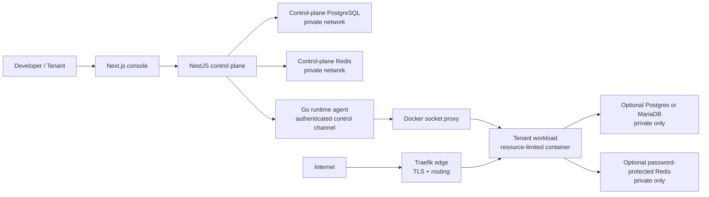
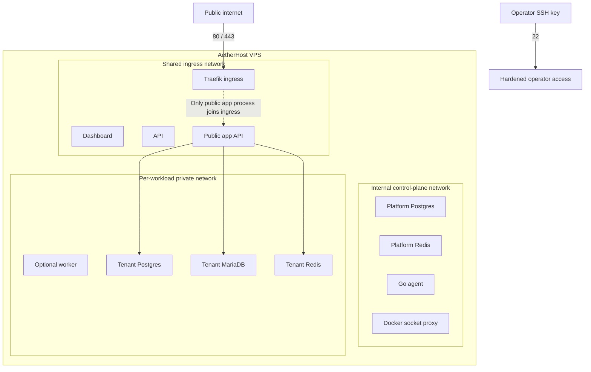
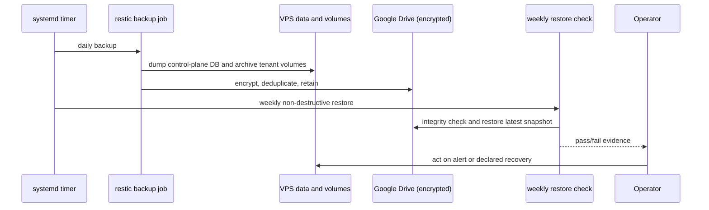

# AetherHost Reliability & Security Architecture

AetherHost is a developer-facing hosting control plane with a deliberately separated execution layer. This upgrade adds secure workload defaults, credentialed private datastores, off-host backup automation, restore drills, and bounded cache maintenance without changing the routes or compose files of existing applications.

## Production request and control flow

## Network boundaries

## Recovery and operational feedback loop

## Reliability contract

| Concern | Platform control | Evidence to retain |
| --- | --- | --- |
| Availability | readiness checks, restart policy, health probes, safe failure teardown | deployment log and health result |
| Capacity | CPU, memory and PID ceilings; 10GB bounded BuildKit cache | dashboard telemetry and maintenance logs |
| Data integrity | private credentialed data services; encrypted off-host backups | backup report and weekly restore drill |
| Security | no public datastore ports, non-privileged workload defaults, least-privilege Docker proxy | compose output and security review |
| Developer experience | one deployment contract for app, worker and optional data services | generated workload manifest and runbook |

## Compatibility rules

1. Existing applications continue to use their existing deployment manifests.
2. Postgres, MariaDB, and Redis are opt-in for new image workloads.
3. The API migration adds a boolean with a false default; it does not modify existing workload records.
4. Backups and maintenance are systemd jobs outside the request path. They do not restart tenant applications.

## Scope boundary

This is a production-minded single-node platform, not a claim of globally distributed or multi-region high availability. Its engineering value is a repeatable, observable operating model with tested recovery and explicit resource boundaries.
