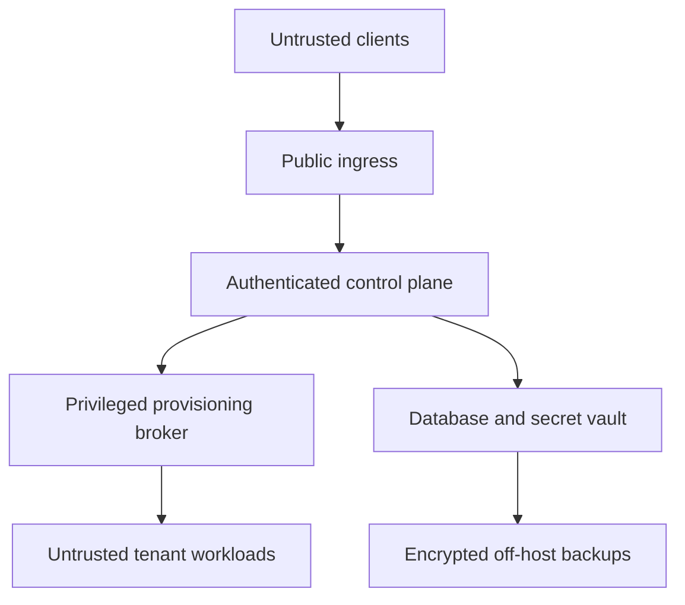

# AetherHost infrastructure threat model

Reviewed 19 November 2026. This model describes repository controls and residual
risks, not an assertion of verified production security. Read it with `controls.md`
and the latest validation report.

Private Rust service access uses a separate expiring-credential registry. It must
not replace the public application ingress policy. The provisioning broker's Docker
lifecycle authority remains a highly privileged boundary; a discovery-only proxy
cannot remove the privileges needed to provision workloads.

| Threat | Existing or newly implemented control | Residual risk / required evidence |
| --- | --- | --- |
| Spoofed role or tenant headers | Server-owned Rust/Actix identity registry and resource ownership | Trusted ownership reconciliation, credential provisioning and observed revocation |
| Cross-tenant management or log access | API ownership checks and Rust policy evaluation | Deployed endpoint tests; keep browser clients behind a trusted identity adapter |
| Stolen long-lived service credential | Explicit expiry, registry removal/restart, bounded WebSocket sessions | Protected token distribution and rotation; dynamic workload identity remains a future adapter |
| Untrusted workload reaches host Docker authority | Separate discovery proxy; restricted runtime mounts/profiles; path containment | Provisioning broker retains lifecycle privileges. Verify workload network isolation and broker authorization |
| Tenant source overwrites control plane | Separate project/control paths and regression tests | Effective filesystem ownership, symlink behavior and deployed mount verification |
| Secret ciphertext tampering or relocation | AES-GCM authenticated key ID/application context and strict parsing | Secure key provisioning; all legacy rows must be migrated |
| Encryption key compromise or loss | Named-key rotation and migration tooling | Protected recovery keys, external secret management/KMS integration, backup retention review |
| Untrusted or stale release image | CI-gated signing; signer/issuer/revision verification; digest deployment | Successful real Cosign evidence, protected branch/environment and root-owned deploy scripts |
| Credential leakage in logs/build context | API redaction and Docker context secret exclusions | Redaction is pattern-based, not a complete DLP system; verify each new data flow |
| Audit deletion or repudiation | Structured decision events, DB audit records, proposed runtime audit permission restrictions | Durable collector, verified least-privilege DB logins and independent tamper-resistant retention |
| Vulnerability persists after deployment | Scheduled source scans, digest inventory and fleet scanner | Install scanner; triage findings and expiring inherited exceptions; retain remediation evidence |
| Recovery snapshot missing, corrupt or stale | Off-host backup scripts; sampled integrity check; snapshot-age gate; isolated SQL load | Run current drill, confirm backup cadence and complete user-workflow recovery |
| Kubernetes lateral movement | Namespace admission policy, non-root/seccomp, scoped ingress/egress policy | CNI enforcement and live negative network tests; these policies cover platform pods, not every tenant workload |
| Cloud misconfiguration | Cloudflare/GitHub Terraform and isolated AWS security root | Reviewed plans, protected remote state, deployed CSPM assessment and drift evidence |

User-agent probe filtering is easily spoofed and is not a complete WAF. Container
namespaces do not establish VM-level isolation. Repository manifests do not prove
the effective deployed configuration. Track each remaining risk with owner,
priority, due date, and observed verification rather than marking a category
universally mitigated.
